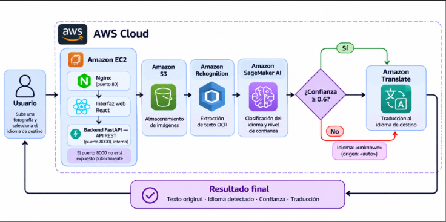

# Ixtli: traductor de texto en imágenes

Sistema que recibe una fotografía, **detecta el texto** que aparece en ella, **identifica su idioma** con un
clasificador entrenado por nosotros y lo **traduce** al idioma del usuario. Está construido sobre servicios de AWS y
expuesto mediante una API REST.

> Proyecto de INTEGRACION DE SERVICIOS DE APRENDIZAJE AUTOMATICO.
>
> **Autores:**  
> Paulina Flores Sánchez, [paulina.floress@iteso.mx](mailto:paulina.floress@iteso.mx)  
> Angel Aceves Manzo, [angel.aceves@iteso.mx](mailto:angel.aceves@iteso.mx)

## Contenido

1. [Problema](#1-problema)
2. [Arquitectura](#2-arquitectura)
3. [Servicios de AWS](#3-servicios-de-aws)
4. [Estructura del repositorio](#4-estructura-del-repositorio)
5. [Requisitos previos](#5-requisitos-previos)
6. [Instalación del entorno](#6-instalación-del-entorno)
7. [Datos](#7-datos)
8. [Modelo de aprendizaje automático](#8-modelo-de-aprendizaje-automático)
9. [Despliegue en AWS](#9-despliegue-en-aws)
10. [Ejecución local](#10-ejecución-local)
11. [Pruebas y CI/CD](#11-pruebas-y-cicd)
12. [Monitoreo](#12-monitoreo)
13. [Uso responsable y póster](#13-uso-responsable-y-póster)
14. [Créditos y licencias](#14-créditos-y-licencias)

## 1. Problema

Quienes viajan, estudian o migran a un país con otro idioma se enfrentan a letreros, menús, etiquetas y avisos que no
comprenden. La solución habitual (transcribir el texto a mano en un traductor) es lenta y propensa a errores.

Ixtli automatiza ese flujo: a partir de una foto devuelve el texto detectado, su idioma y su traducción.


**Idiomas soportados por el clasificador:** español, inglés, portugués, francés, italiano y alemán. Si el clasificador
no alcanza el umbral de confianza, el texto se marca como *desconocido* y la identificación del idioma se delega a
Amazon Translate.

## 2. Arquitectura




1. El usuario envía una imagen a la API.
2. La imagen se almacena en Amazon S3 y se detecta su texto con Amazon Rekognition.
3. Cada línea detectada pasa por el clasificador de idioma.
4. La API utiliza el idioma estimado para traducir el texto cuando corresponde. Si la confianza es inferior a 0.6,
   SageMaker devuelve `unknown` y la API solicita la autodetección de Amazon Translate.

## 3. Servicios de AWS

| Servicio | Uso en el proyecto |
|---|---|
| Amazon EC2 | Alojamiento de FastAPI y del frontend estático mediante Nginx |
| Amazon S3 | Almacenamiento de imágenes y del artefacto del modelo |
| Amazon Rekognition | Detección de texto en la imagen (`DetectText`) |
| Amazon SageMaker | Hospedaje del clasificador de idioma entrenado por el equipo |
| Amazon Translate | Traducción del texto al idioma de destino |
| AWS IAM | Permisos entre servicios |


## 4. Estructura del repositorio

```
.
├── .github/          Flujos de trabajo de GitHub Actions (integración continua)
├── api/              API REST con FastAPI
├── configs/          config.yaml: idiomas, datos, ruido sintético y modelo
├── data/             Datos de WiLI-2018
├── frontend/         Interfaz web con React y Vite
├── docs/             Documentación del proyecto
├── imagenes/         Fotografías de ejemplo
├── models/           Salida del entrenamiento local
├── notebooks/        01_modelo_clasificador_idioma.ipynb (datos, entrenamiento y comparación)
├── reports/          Figuras y métricas generadas por el notebook
├── sagemaker/        Empaquetado e inferencia del modelo para SageMaker
├── scripts/          Scripts auxiliares
├── src/traductor/    Código fuente del paquete (datos, modelos, utilidades de AWS)
├── terraform/        Infraestructura como código
├── tests/            Pruebas automatizadas del proyecto
├── Makefile          Atajos de desarrollo (setup, test, lint, ...)
├── requirements.txt          Dependencias de ejecución
└── requirements-dev.txt      Dependencias de desarrollo (entrenamiento, pruebas, linter)
```

## 5. Requisitos previos

- Python 3.11 o superior.
- Git.
- Node.js 22.12 o superior y npm para el frontend. CI usa Node.js 22.
- [AWS CLI](https://docs.aws.amazon.com/cli/latest/userguide/getting-started-install.html) instalado y **configurado**
  con credenciales válidas. Se verifica con:

  ```bash
  aws sts get-caller-identity
  ```

- [Terraform](https://developer.hashicorp.com/terraform/install) 1.5 o superior para aprovisionar AWS.

## 6. Instalación del entorno

Desde la carpeta raíz del proyecto.

**Windows (PowerShell)**

```powershell
python -m venv .venv
.\.venv\Scripts\Activate.ps1
pip install -r requirements-dev.txt
```

**macOS / Linux**

```bash
python3 -m venv .venv
source .venv/bin/activate
pip install -r requirements-dev.txt
```

Para ejecutar la aplicación basta con instalar `requirements.txt` desde la raíz.
`requirements-dev.txt` agrega los paquetes de entrenamiento y pruebas.

## 7. Datos

Se utiliza **WiLI-2018** (Wikipedia Language Identification), descargado de Kaggle y colocado en la carpeta `data/`,
tal como se descarga:

- `wili_6idiomas_train.csv` y `wili_6idiomas_test.csv`, o bien
- `x_train.txt`, `y_train.txt`, `x_test.txt` e `y_test.txt` (formato original de WiLI).

Se respetan las particiones de entrenamiento y prueba del dataset y se filtran los seis idiomas del proyecto. La fuente
se configura en `configs/config.yaml` (`data.source`, `data.local_dir`, `data.local_format`). Los archivos `.txt`
pesados no se versionan.


## 8. Modelo de aprendizaje automático

El componente propio del proyecto es un clasificador de idioma para fragmentos cortos de texto.

- **Representación:** TF-IDF sobre n-gramas de caracteres (1 a 4).
- **Configuraciones comparadas:** Naive Bayes multinomial y regresión logística.
- **Preparación de datos:** partición entrenamiento/validación por párrafo (para evitar fuga de información),
  fragmentación a 1-5 palabras y ruido sintético tipo OCR con mayúsculas, para parecerse a lo que devuelve Rekognition.

La regresión logística fue seleccionada por su F1 macro de 0.854 en validación con ruido. En la prueba oficial
de WiLI-2018 obtuvo estos resultados:

| Conjunto de prueba | Exactitud | F1 macro |
|---|---:|---:|
| Texto limpio | 0.8708 | 0.8708 |
| Texto con ruido sintético | 0.8575 | 0.8575 |

El notebook genera:

- las figuras en `reports/figures/`,
- las métricas en `reports/metricas_validacion.csv` y `reports/metricas_prueba.json`,
- el artefacto del modelo en `models/language_clf.joblib`.

## 9. Despliegue en AWS

### 9.1 Preparar el modelo y la infraestructura

Terraform usa `sagemaker/model.tar.gz` como entrada, sube el archivo a S3 y configura SageMaker para leerlo.
El repositorio incluye ese paquete. Para desplegar el de una ejecución de CI, descarga el artefacto y coloca
el `model.tar.gz` que contiene en esa misma ruta antes de planificar el despliegue.

El paquete contiene `language_clf.joblib` en la raíz y `inference.py` y `requirements.txt` dentro de `code/`.
El endpoint usa una imagen preconstruida de scikit-learn para CPU. Recibe JSON con el campo `text` y devuelve
`language` y `confidence`.

Configura un par de llaves de EC2 existente y el CIDR desde el que te conectarás por SSH en
`terraform/terraform.tfvars`. Los siguientes valores son ejemplos:

```hcl
ec2_key_name = "ixtli-key-pair"
admin_cidr   = "203.0.113.10/32"
```

La configuración parte de la VPC predeterminada en `us-east-1`. Si modificas los nombres del bucket o el endpoint,
o la región, ajusta también las constantes correspondientes en [api/main.py](api/main.py).

```bash
cd terraform
terraform init
terraform validate
terraform plan
terraform apply
terraform output
```

`terraform apply` aprovisiona recursos facturables, entre ellos EC2 y el endpoint de SageMaker.

### 9.2 Publicar la aplicación en EC2

1. Conéctate a la IP pública devuelta por Terraform con
   `ssh -i RUTA_A_LA_LLAVE.pem ec2-user@IP_PUBLICA`.
2. En la instancia, instala Git, Python, Node.js con npm y Nginx. Clona el repositorio en un directorio de
   trabajo como `/var/www/ixtli` e instala las dependencias del backend desde el `requirements.txt` de la raíz.
3. Configura un servicio de systemd con el directorio de trabajo en `/var/www/ixtli/api`. Usa el ejecutable de
   Uvicorn de tu entorno virtual con `main:app --host 127.0.0.1 --port 8000`. Verifica que la API local responda
   con `curl -f http://127.0.0.1:8000/health`.
4. En `frontend/`, ejecuta `npm ci` y `npm run build`, o usa el build entregado por CI. Para servir el frontend
   y la API desde el mismo origen, deja `VITE_API_URL` sin definir para el build de producción.
5. Configura Nginx para servir `frontend/dist`, redirigir rutas de la interfaz a `index.html` y enviar
   `/images` a Uvicorn:

```nginx
server {
    listen 80;
    server_name IP_PUBLICA;
    root /var/www/ixtli/frontend/dist;
    index index.html;
    client_max_body_size 11m;

    location / {
        try_files $uri $uri/ /index.html;
    }

    location /images {
        proxy_pass http://127.0.0.1:8000;
    }
}
```

Reemplaza `IP_PUBLICA` por la IP de EC2. Valida la configuración con `sudo nginx -t`, inicia o recarga Nginx y abre `http://IP_PUBLICA`.
Comprueba la carga y traducción de una fotografía de ejemplo desde la interfaz.

## 10. Ejecución local

Con el entorno virtual activado y las dependencias instaladas, inicia el backend desde la raíz:

```bash
python -m uvicorn main:app --app-dir api --host 127.0.0.1 --port 8000
```

En otra terminal, inicia el frontend desde la raíz:

```bash
npm ci --prefix frontend
npm run dev --prefix frontend
```

Abre `http://localhost:5173`. El frontend lee la URL de la API desde
[`frontend/.env.development`](frontend/.env.development). La documentación interactiva de FastAPI está en
`http://127.0.0.1:8000/docs`. Para traducir imágenes desde el entorno local, la API necesita credenciales y acceso a
los recursos de AWS del proyecto.

### Rutas de la API

| Método y ruta | Uso |
|---|---|
| `GET /` | Consultar la respuesta inicial de la API |
| `POST /images` | Subir una imagen mediante el campo multipart `file` |
| `GET /images` | Listar imágenes guardadas en S3 |
| `GET /images/{image_id}` | Consultar una imagen por su identificador |
| `DELETE /images/{image_id}` | Eliminar una imagen |
| `POST /images/{image_id}/process?target_language=es` | Detectar, clasificar y traducir su texto |
| `GET /health` | Comprobar que la API responde |
| `GET /metrics` | Consultar métricas en formato Prometheus |

## 11. Pruebas y CI/CD

Ejecuta las pruebas y el análisis estático desde la raíz:

```bash
python -m pytest -q
ruff check api src scripts tests --select E,F,I,UP --line-length 110
```

El workflow [CI](.github/workflows/ci.yml) corre en pushes a `main`, pull requests y ejecuciones manuales.
Ejecuta Ruff, Bandit y pytest, comprueba el frontend con ESLint y Vite, y valida Terraform sin aplicar cambios.
La suite usa respuestas simuladas de AWS y prueba el flujo de inferencia local con el modelo empaquetado.

| Artefacto | Contenido | Condición de publicación |
|---|---|---|
| `frontend-dist-<sha>` | Archivos estáticos de `frontend/dist/` | Pasa el job del frontend |
| `sagemaker-model-<sha>` | `model.tar.gz` con el clasificador y el código de inferencia | Pasan los jobs de análisis, pruebas, frontend y Terraform |

La publicación se omite en pull requests. Los artefactos quedan descargables durante 14 días en la sección
**Artifacts** de cada ejecución. El sufijo identifica el commit que los generó. El despliegue en AWS se realiza
por separado, como se describe en la sección 9. La [ejecución de referencia](https://github.com/Angel751658/Ixtli/actions/runs/45462795174)
completó los cinco trabajos y publicó ambos artefactos.

## 12. Monitoreo

La API expone dos rutas para monitoreo:

- `GET /health`: confirma que el proceso HTTP está disponible; no invoca servicios de AWS.
- `GET /metrics`: expone métricas en formato Prometheus. Configura Prometheus para recolectar esta ruta.

Se registran solicitudes y latencia HTTP por ruta/estado, conteo y confianza de predicciones por idioma, duración de
inferencias de SageMaker, conteo/latencia de traducciones y errores de SageMaker o Translate. Las etiquetas de idioma
se limitan a un conjunto fijo para evitar cardinalidad no acotada; el texto de las imágenes no se incluye en las
métricas.

La confianza y la latencia permiten observar cambios operativos, pero no sustituyen una medición de exactitud. Para
calcular calidad del modelo se requieren etiquetas reales; las métricas de evaluación etiquetada disponibles están en
[`reports/metricas_prueba.json`](reports/metricas_prueba.json).

## 13. Uso responsable y póster

Ixtli está pensado para ayudar a viajeros, estudiantes de intercambio y personas recién llegadas a otro país
a interpretar letreros, menús y etiquetas. La iluminación, el ángulo de la foto, la tipografía o los errores de lectura
pueden afectar el resultado. Para decisiones médicas, legales o relacionadas con alérgenos, verifica el texto
con una fuente confiable. El ruido sintético durante el entrenamiento y la autodetección cuando la confianza
es baja ayudan a manejar entradas difíciles.

[Póster de Ixtli](https://canva.link/d08torjzg7lss00)

## 14. Créditos y licencias

- **Dataset:** WiLI-2018, publicado bajo la licencia *ODC Open Database License v1.0*.
  Thoma, M. (2018). *The WiLI benchmark dataset for written language identification*. arXiv:1801.07779.
- **Servicios:** Amazon Web Services (S3, Rekognition, SageMaker, Translate).
- **Autores:** Paulina Flores Sánchez, Angel Aceves Manzo.


```
⠀⠀⠀⠀⢠⡶⠚⢷⣤⡀⠀⠀⠀⠀⠀⣲⡶⠛⠻⣆⠀⠀⠀⠀⠀⠀⠀⠀⠀⠀           
⠀⠀⠀⢠⡿⠁⠀⠀⠙⣷⣄⠀⢀⣴⡟⠁⠀⠀⢷⢹⡆⠀⠀⠀⠀⠀⠀⠀⠀⠀
⠀⠀⠀⣾⠃⠀⠠⠶⠚⠛⠛⠛⠛⠋⠀⠀⣀⡀⢸⠈⣿⠀⠀⠀⠀⠀⠀⠀⠀⠀
⠀⠀⢸⣏⡔⠋⠀⠀⠀⠀⠀⠀⠀⠀⠀⠚⠉⠉⣿⠀⢹⠀⠀⠀⠀⠀⠀⠀⠀⠀
⠀⠀⢾⠏⠀⠀⠀⠀⠀⠀⠀⠀⠀⠀⠀⠀⠀⠀⠸⠀⢸⡇⠀⠀⠀⠀⠀⠀⠀⠀
⠀⢠⣿⢠⣶⡆⠀⠀⠀⠀⣀⣀⠀⠀⠀⠀⠀⠀⠀⠀⢸⡇⠀⠀⠀⠀⠀⠀⠀⠀
⢒⡾⠁⠘⠟⠁⠀⠀⠀⠀⣿⣿⡆⠀⠀⠀⠀⠀⠀⠀⢸⡇⠀⠀⠀⠀⠀⠀⠀⠀
⠉⣧⠀⠀⠀⠀⠃⠀⠀⠀⠈⠉⠠⣍⠀⠀⠀⠀⠀⠀⣸⡇⢀⣤⠶⠛⠛⠻⢦⣄
⠀⠸⣧⡀⠀⠀⠀⠀⠀⠀⠀⠀⠀⠀⠀⠀⠀⠀⠀⣰⡟⣴⠟⠁⠀⠀⠀⠀⠀⢻
⠀⠀⠀⠛⣷⡦⠀⠀⠀⠀⠀⠀⠀⠀⣀⣀⣤⡴⠞⠋⢠⡟⠀⠀⠀⠀⠀⠀⢀⡾
⠀⠀⠀⢰⡿⠀⠀⠀⠀⠀⠀⠀⠀⠀⠀⠀⠉⠳⣤⡀⢸⠃⠀⠀⠀⠀⢠⡶⠟⠁
⠀⠀⠀⣸⠇⠀⠀⠀⠀⠀⠀⠀⠀⠀⠀⠀⠀⠀⠘⢷⣹⡄⠀⠀⠀⠀⣼⠀⠀⠀
⠀⠀⠀⣿⠀⠀⠀⠀⠀⠀⠀⠀⠀⠀⠀⠀⠀⠀⠀⠈⢿⣇⠀⠀⠀⠀⢹⡄⠀⠀
⠀⠀⠀⢸⡀⢀⠀⠀⠀⠀⠀⠀⠀⠀⠀⠀⠀⠀⠀⠀⠈⣿⡄⠀⠀⠀⠈⣧⠀⠀
⠀⠀⠀⢸⡇⠘⡇⠀⠀⠀⠀⠀⠀⠀⣀⠀⠀⠀⠀⠀⠀⢸⣿⠀⠀⠀⠀⢹⡇⠀
⠀⠀⠀⢸⡇⠀⠙⠀⠀⠀⠀⠀⢠⠞⠁⠀⠀⠀⠀⠀⠀⠀⣿⠇⠀⠀⠀⢸⡇⠀
⠀⠀⠀⢸⡇⠀⢸⡆⠀⠀⠀⠀⣟⠀⠀⠀⠀⠀⠀⠀⠀⠀⠛⠀⠀⠀⠀⣸⠇⠀
⠀⠀⠀⢸⣿⠀⠀⡇⠀⠀⠀⠀⣿⡀⠀⠀⠀⠀⠀⠀⠀⢀⡇⠀⠀⢀⣴⡟⠁⠀
⠀⠀⠀⠘⠿⠶⢶⢧⣦⣦⡴⢾⣥⣽⣤⣤⣤⣤⣤⣤⡴⣯⡤⠴⠶⠛⠋⠀⠀⠀
⠀⠀⠀⠀⠀⠀⠀⠀⠀⠀⠀⠀⠀⠀

```
```⠀⠀⠀⠀⠀⠀⠀⠀⠀⠀⠀⠀⠀⠀⠀⠀⠀⠀⠀⠀⠀⠀⠀⠀⠀⠀⠀⠀⠀⠀⠀⠀⠀⠀⠀
⠀⠀⠀⠀⠀⠀⠀⠀⠀⢀⣴⣷⣆⠀⠀⣴⣿⣷⣄⡀⠀⠀⠀⣀⣀⠀⠀⠀⠀⠀⠀⠀⠀⠀⠀
⠀⠀⠀⠀⠀⠀⠀⠀⢀⣾⣿⣿⣿⣧⣼⣿⣿⣿⣯⠙⣄⢀⡞⠁⠘⣆⠀⠀⠀⠀⠀⠀⠀⠀⠀
⠀⠀⠀⠀⠀⠀⠀⢠⣾⣿⣿⣿⣿⣿⣿⣿⣿⣿⣿⣧⠈⠉⠀⠀⠀⠸⣄⠀⠀⠀⠀⠀⠀⠀⠀
⠐⠚⠋⠉⣛⣛⠀⣾⣿⣿⣿⣿⣿⣿⣿⣿⣿⣿⣿⣿⡆⠀⠀⠀⠀⠀⠘⡆⠀⠀⠀⠀⠀⠀⠀
⠀⠀⠐⠉⠁⠀⠀⢻⣿⣿⣿⣿⣿⣿⣿⣿⣿⣿⣿⣿⡇⠀⠀⠀⠀⠀⠀⢹⠀⠸⢟⣓⠒⠦⠄
⠀⠀⠀⠀⠀⠀⠀⠈⢻⣿⣿⣿⣿⣿⣿⣿⣿⣿⣿⠟⠁⠀⠀⠀⠀⠀⠀⡾⠀⠀⠈⠙⠆⠀⠀
⠀⠀⠀⠀⠀⠀⠀⢠⣿⣿⣿⣿⣿⣿⣿⣿⣿⣿⣷⠀⠀⠀⠀⠀⣀⡠⣾⡁⠀⠀⠀⠀⠀⠀⠀
⠀⠀⠀⠀⠀⠀⢠⣿⣿⣿⣿⣿⣿⣿⣿⣿⣿⣿⣿⡆⠀⠀⠀⠀⠁⠀⠀⠙⢦⡀⠀⠀⠀⠀⠀
⠀⠀⠀⠀⠀⠀⣿⣿⣿⣿⣿⣿⣿⣿⣿⣿⣿⣿⣿⡇⠀⠀⠀⠀⠀⠀⠀⠀⠀⢹⡀⠀⠀⠀⠀
⠀⠀⠀⠀⠀⠀⢿⣿⣿⣿⣿⣿⣿⣿⣿⣿⣿⣿⣿⡇⠀⠀⠀⠀⠀⠀⠀⠀⠀⢸⠇⠀⠀⠀⠀
⠀⠀⠀⠀⠀⠀⠘⢿⣿⣿⣿⣿⣿⣿⣿⣿⣿⣿⣿⡀⠀⠀⠀⠀⠀⢀⣀⣠⠴⠋⠀⠀⠀⠀⠀
⠀⠀⠀⠀⠀⠀⠀⠀⠈⠛⣿⣿⡿⠻⠟⠛⠛⠁⠀⠉⠉⢉⣻⠟⠉⡏⠁⠀⠀⠀⠀⠀⠀⠀⠀
⠀⠀⠀⠀⠀⠀⠀⠀⠀⠀⢿⣿⣿⡀⠀⠀⠀⠀⡰⠒⠙⠉⠀⠀⣰⠃⠀⠀⠀⠀⠀⠀⠀⠀⠀
⠀⠀⠀⠀⠀⠀⠀⠀⠀⠀⠸⣿⣿⣧⠀⠀⠀⠀⠷⣄⣀⣠⠤⠔⠋⠀⠀⠀⠀⠀⠀⠀⠀⠀⠀
⠀⠀⠀⠀⠀⠀⠀⠀⠀⠀⠀⠹⢿⣿⣷⠀⠀⠀⠀⠀⠀⠀⠀⠀⠀⠀⠀⠀⠀⠀⠀⠀⠀⠀⠀
⠀⠀⠀⠀⠀⠀⠀⠀⠀⠀⠀⠀⠀⠉⠁⠀⠀⠀⠀⠀⠀⠀⠀⠀⠀⠀⠀⠀⠀⠀⠀⠀⠀⠀⠀
```