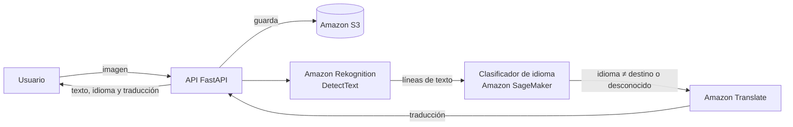

# Ixtli: traductor de texto en imágenes

Sistema que recibe una fotografía, **detecta el texto** que aparece en ella, **identifica su idioma** con un
clasificador entrenado por nosotros y lo **traduce** al idioma del usuario. Está construido sobre servicios de AWS y
expuesto mediante una API REST.

> Proyecto de INTEGRACION DE SERVICIOS DE APRENDIZAJE AUTOMATICO.

> Autores: Paulina Flores Sánchez, Angel Aceves Manzo

## Contenido

1. [Problema](#1-problema)
2. [Arquitectura](#2-arquitectura)
3. [Servicios de AWS](#3-servicios-de-aws)
4. [Estructura del repositorio](#4-estructura-del-repositorio)
5. [Requisitos previos](#5-requisitos-previos)
6. [Instalación del entorno](#6-instalación-del-entorno)
7. [Datos](#7-datos)
8. [Modelo de aprendizaje automático](#8-modelo-de-aprendizaje-automático)
9. [Despliegue en AWS](#9-despliegue-en-aws)
10. [Ejecución de la API](#10-ejecución-de-la-api)
11. [Pruebas y calidad de código](#11-pruebas-y-calidad-de-código)
12. [Limitaciones y consideraciones éticas](#12-limitaciones-y-consideraciones-éticas)
13. [Seguridad y buenas prácticas](#13-seguridad-y-buenas-prácticas)
14. [Créditos y licencias](#14-créditos-y-licencias)

## 1. Problema

Quienes viajan, estudian o migran a un país con otro idioma se enfrentan a letreros, menús, etiquetas y avisos que no
comprenden. La solución habitual (transcribir el texto a mano en un traductor) es lenta y propensa a errores.

Ixtli automatiza ese flujo: a partir de una foto devuelve el texto detectado, su idioma y su traducción.


**Idiomas soportados por el clasificador:** español, inglés, portugués, francés, italiano y alemán. Si el clasificador
no alcanza el umbral de confianza, el texto se marca como *desconocido* y la identificación del idioma se delega a
Amazon Translate.

## 2. Arquitectura




1. El usuario envía una imagen a la API.
2. La imagen se almacena en Amazon S3 y se detecta su texto con Amazon Rekognition.
3. Cada línea detectada pasa por el clasificador de idioma.
4. Si el idioma es distinto al de destino (o es desconocido), se traduce con Amazon Translate.

## 3. Servicios de AWS

| Servicio | Uso en el proyecto |
|---|---|
| Amazon S3 | Almacenamiento de imágenes y del artefacto del modelo |
| Amazon Rekognition | Detección de texto en la imagen (`DetectText`) |
| Amazon SageMaker | Hospedaje del clasificador de idioma entrenado por el equipo |
| Amazon Translate | Traducción del texto al idioma de destino |
| AWS IAM | Permisos entre servicios |


## 4. Estructura del repositorio

```
.
├── .github/          Flujos de trabajo de GitHub Actions (integración continua)
├── api/              API REST con FastAPI
├── configs/          config.yaml: idiomas, datos, ruido sintético y modelo
├── data/             Dataset WiLI-2018 (Kaggle) y fotografías de prueba
├── docs/             Documentación del proyecto
├── models/           Artefactos entrenados (no se versionan)
├── notebooks/        01_modelo_clasificador_idioma.ipynb (datos, entrenamiento y comparación)
├── reports/          Figuras y métricas generadas por el notebook
├── sagemaker/        Empaquetado e inferencia del modelo para SageMaker
├── scripts/          Scripts auxiliares
├── src/traductor/    Código fuente del paquete (datos, modelos, utilidades de AWS)
├── terraform/        Infraestructura como código
├── Makefile          Atajos de desarrollo (setup, test, lint, ...)
├── requirements.txt          Dependencias de ejecución
└── requirements-dev.txt      Dependencias de desarrollo (entrenamiento, pruebas, linter)
```

## 5. Requisitos previos

- Python 3.11 o superior.
- Git.
- [AWS CLI](https://docs.aws.amazon.com/cli/latest/userguide/getting-started-install.html) instalado y **configurado**
  con credenciales válidas. Se verifica con:

  ```bash
  aws sts get-caller-identity
  ```

- [Terraform](https://developer.hashicorp.com/terraform/install).

## 6. Instalación del entorno

Desde la carpeta raíz del proyecto.

**Windows (PowerShell)**

```powershell
python -m venv .venv
.venv\Scripts\Activate.ps1
pip install -r requirements-dev.txt
```

**macOS / Linux**

```bash
python3 -m venv .venv
source .venv/bin/activate
pip install -r requirements-dev.txt
```

Si el comando `fastapi` no se reconoce, -> `pip install "fastapi[standard]"`.

## 7. Datos

Se utiliza **WiLI-2018** (Wikipedia Language Identification), descargado de Kaggle y colocado en la carpeta `data/`,
tal como se descarga:

- `wili_6idiomas_train.csv` y `wili_6idiomas_test.csv`, o bien
- `x_train.txt`, `y_train.txt`, `x_test.txt` e `y_test.txt` (formato original de WiLI).

Se respetan las particiones de entrenamiento y prueba del dataset y se filtran los seis idiomas del proyecto. La fuente
se configura en `configs/config.yaml` (`data.source`, `data.local_dir`, `data.local_format`). Los archivos `.txt`
pesados no se versionan.


## 8. Modelo de aprendizaje automático

El componente propio del proyecto es un clasificador de idioma para fragmentos cortos de texto.

- **Representación:** TF-IDF sobre n-gramas de caracteres (1 a 4).
- **Configuraciones comparadas:** Naive Bayes multinomial y regresión logística.
- **Preparación de datos:** partición entrenamiento/validación por párrafo (para evitar fuga de información),
  fragmentación a 1-5 palabras y ruido sintético tipo OCR con mayúsculas, para parecerse a lo que devuelve Rekognition.

El notebook genera:

- las figuras en `reports/figures/`,
- las métricas en `reports/metricas_validacion.csv` y `reports/metricas_prueba.json`,
- el artefacto del modelo en `models/language_clf.joblib`.

## 9. Despliegue en AWS

### 9.1 Infraestructura con Terraform

Dentro de la carpeta `terraform/`:

```bash
terraform init
terraform validate
terraform plan
terraform apply
```

### 9.2 Empaquetar y publicar el modelo en SageMaker

Dentro de la carpeta `sagemaker/`:

```powershell
# 1. Estructura del paquete
New-Item -ItemType Directory -Force package\code

# 2. Artefacto del modelo y código de inferencia
Copy-Item model\language_clf.joblib package\
Copy-Item code\inference.py package\code\
Copy-Item code\requirements.txt package\code\

# 3. Comprimir
tar -czf model.tar.gz -C package .

# 4. Subir a S3
aws s3 cp model.tar.gz s3://ixtli-images/sagemaker/model.tar.gz
```

El archivo `model.tar.gz` contiene el modelo en la raíz y el código de inferencia en `code/`, que es la estructura que
SageMaker espera.

<!-- VERIFICAR: que sagemaker/model/ contenga el language_clf.joblib generado por el notebook y que el orden Terraform -> subida del modelo sea el correcto. -->

## 10. Ejecución de la API

Dentro de la carpeta `api/`, con el entorno virtual activado:

```bash
fastapi dev main.py
```

La documentación interactiva queda disponible en `http://127.0.0.1:8000/docs`.


## Créditos y licencias

- **Dataset:** WiLI-2018, publicado bajo la licencia *ODC Open Database License v1.0*.
  Thoma, M. (2018). *The WiLI benchmark dataset for written language identification*. arXiv:1801.07779.
- **Servicios:** Amazon Web Services (S3, Rekognition, SageMaker, Translate).
- **Autores:** Paulina Flores Sánchez, Angel Aceves Manzo.

```
⠀⠀⠀⠀⢠⡶⠚⢷⣤⡀⠀⠀⠀⠀⠀⣲⡶⠛⠻⣆⠀⠀⠀⠀⠀⠀⠀⠀⠀⠀
⠀⠀⠀⢠⡿⠁⠀⠀⠙⣷⣄⠀⢀⣴⡟⠁⠀⠀⢷⢹⡆⠀⠀⠀⠀⠀⠀⠀⠀⠀
⠀⠀⠀⣾⠃⠀⠠⠶⠚⠛⠛⠛⠛⠋⠀⠀⣀⡀⢸⠈⣿⠀⠀⠀⠀⠀⠀⠀⠀⠀
⠀⠀⢸⣏⡔⠋⠀⠀⠀⠀⠀⠀⠀⠀⠀⠚⠉⠉⣿⠀⢹⠀⠀⠀⠀⠀⠀⠀⠀⠀
⠀⠀⢾⠏⠀⠀⠀⠀⠀⠀⠀⠀⠀⠀⠀⠀⠀⠀⠸⠀⢸⡇⠀⠀⠀⠀⠀⠀⠀⠀
⠀⢠⣿⢠⣶⡆⠀⠀⠀⠀⣀⣀⠀⠀⠀⠀⠀⠀⠀⠀⢸⡇⠀⠀⠀⠀⠀⠀⠀⠀
⢒⡾⠁⠘⠟⠁⠀⠀⠀⠀⣿⣿⡆⠀⠀⠀⠀⠀⠀⠀⢸⡇⠀⠀⠀⠀⠀⠀⠀⠀
⠉⣧⠀⠀⠀⠀⠃⠀⠀⠀⠈⠉⠠⣍⠀⠀⠀⠀⠀⠀⣸⡇⢀⣤⠶⠛⠛⠻⢦⣄
⠀⠸⣧⡀⠀⠀⠀⠀⠀⠀⠀⠀⠀⠀⠀⠀⠀⠀⠀⣰⡟⣴⠟⠁⠀⠀⠀⠀⠀⢻
⠀⠀⠀⠛⣷⡦⠀⠀⠀⠀⠀⠀⠀⠀⣀⣀⣤⡴⠞⠋⢠⡟⠀⠀⠀⠀⠀⠀⢀⡾
⠀⠀⠀⢰⡿⠀⠀⠀⠀⠀⠀⠀⠀⠀⠀⠀⠉⠳⣤⡀⢸⠃⠀⠀⠀⠀⢠⡶⠟⠁
⠀⠀⠀⣸⠇⠀⠀⠀⠀⠀⠀⠀⠀⠀⠀⠀⠀⠀⠘⢷⣹⡄⠀⠀⠀⠀⣼⠀⠀⠀
⠀⠀⠀⣿⠀⠀⠀⠀⠀⠀⠀⠀⠀⠀⠀⠀⠀⠀⠀⠈⢿⣇⠀⠀⠀⠀⢹⡄⠀⠀
⠀⠀⠀⢸⡀⢀⠀⠀⠀⠀⠀⠀⠀⠀⠀⠀⠀⠀⠀⠀⠈⣿⡄⠀⠀⠀⠈⣧⠀⠀
⠀⠀⠀⢸⡇⠘⡇⠀⠀⠀⠀⠀⠀⠀⣀⠀⠀⠀⠀⠀⠀⢸⣿⠀⠀⠀⠀⢹⡇⠀
⠀⠀⠀⢸⡇⠀⠙⠀⠀⠀⠀⠀⢠⠞⠁⠀⠀⠀⠀⠀⠀⠀⣿⠇⠀⠀⠀⢸⡇⠀
⠀⠀⠀⢸⡇⠀⢸⡆⠀⠀⠀⠀⣟⠀⠀⠀⠀⠀⠀⠀⠀⠀⠛⠀⠀⠀⠀⣸⠇⠀
⠀⠀⠀⢸⣿⠀⠀⡇⠀⠀⠀⠀⣿⡀⠀⠀⠀⠀⠀⠀⠀⢀⡇⠀⠀⢀⣴⡟⠁⠀
⠀⠀⠀⠘⠿⠶⢶⢧⣦⣦⡴⢾⣥⣽⣤⣤⣤⣤⣤⣤⡴⣯⡤⠴⠶⠛⠋⠀⠀⠀
```